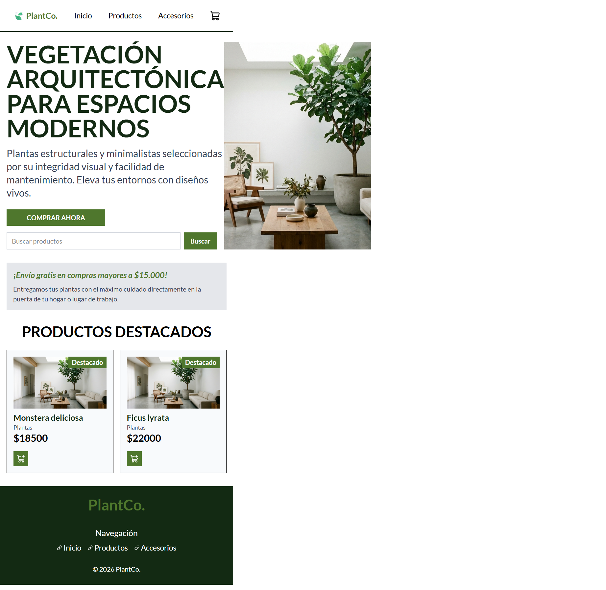
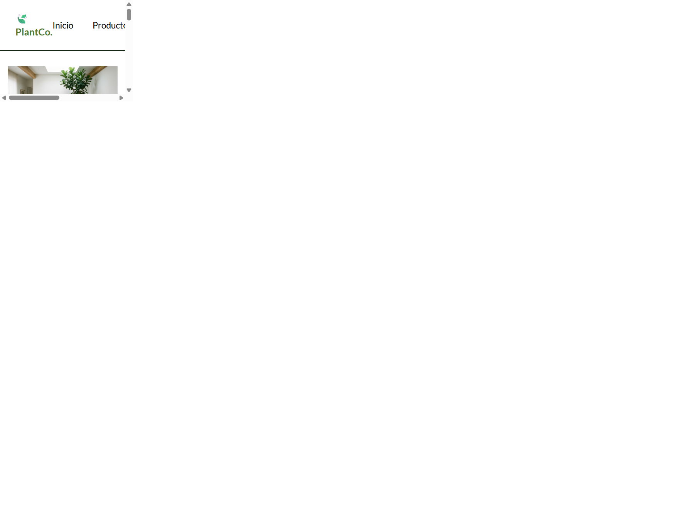
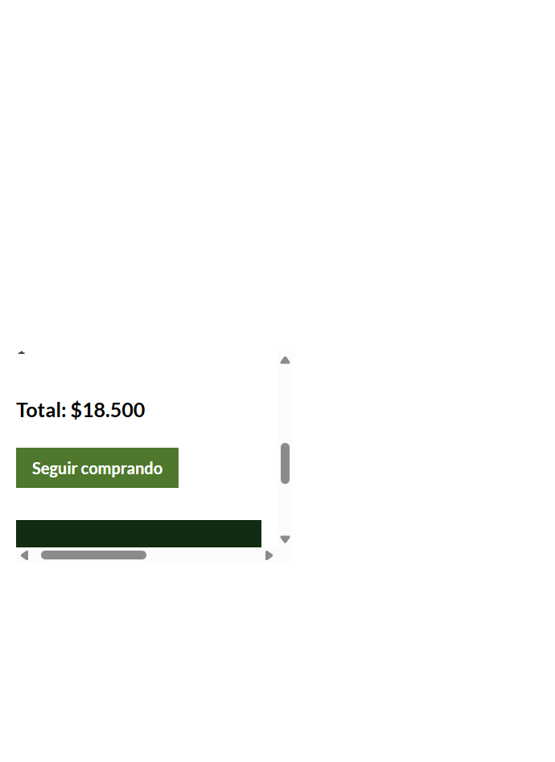
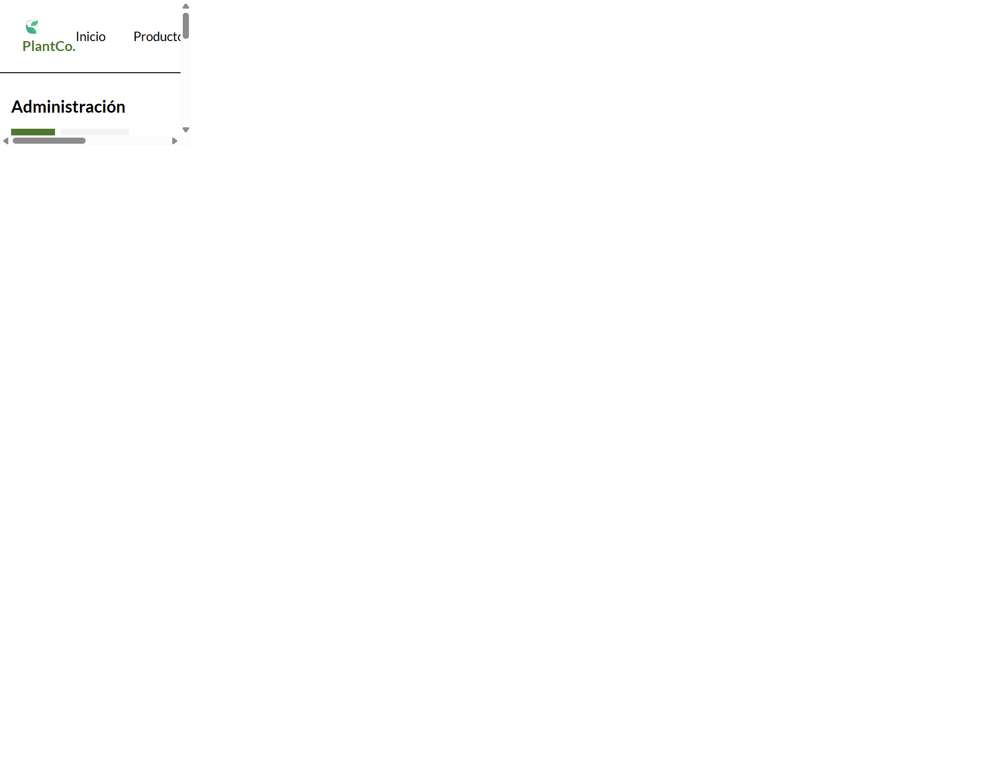

# Recorrido de la aplicación

Las capturas de esta carpeta muestran las pantallas principales del proyecto:

## Inicio

## Catálogo filtrado

## Detalle del producto

## Carrito

## Compra confirmada

## Administración

Para repetir el recorrido localmente, iniciá la app con `npm run dev`. Las
cuentas de demostración están documentadas en el [README principal](../README.md).
